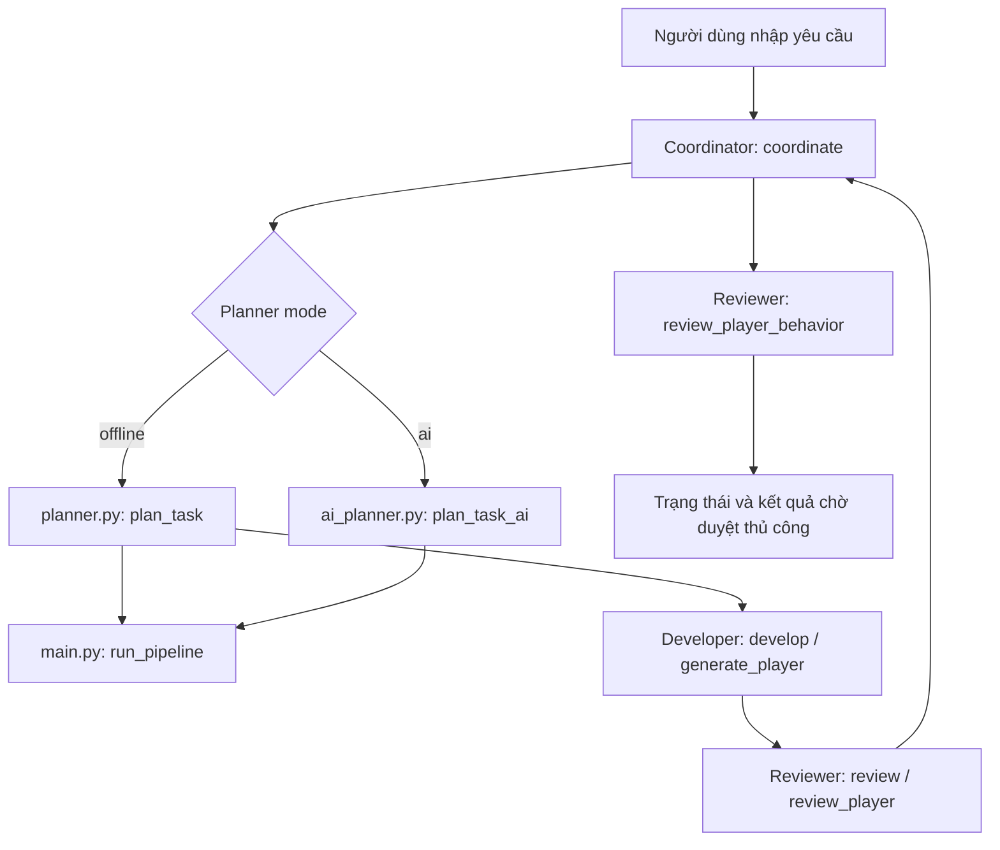

# Kiến trúc Godot AI Agents — 4 vai trò (offline và AI Planner)

> Pipeline mặc định vẫn chạy deterministic ở chế độ `offline`. Chế độ `ai`
> chỉ thay Planner bằng OpenAI Agents SDK; Developer và Reviewer chưa phải
> Agent LLM. Chưa có bằng chứng gọi API thật hoặc tích hợp vào Godot.

## Luồng xử lý

## Vai trò và chức năng đã có

| Vai trò | File | Chức năng trong mã nguồn hiện tại |
| --- | --- | --- |
| Coordinator | `coordinator.py` | Chọn `offline`/`ai`, gọi `run_pipeline`, tổng hợp báo cáo và đặt trạng thái `failed`, `planning_only` hoặc `ready_for_manual_review` |
| Planner | `planner.py`, `ai_planner.py` | Planner offline phân loại theo từ khóa; AI Planner trả structured output `GamePlan`, kiểm tra cấu hình và xử lý lỗi Runner |
| Developer | `developer.py` | `develop()` tạo nhật ký `simulated`; `generate_player()` sinh mẫu Python `player.py` vào thư mục đầu ra |
| Reviewer | `reviewer.py` | Đối chiếu các bước mô phỏng, phân tích cú pháp Python bằng AST, kiểm tra lớp `Player`, phương thức và chuỗi bốn hướng di chuyển |

`main.py` là lớp chạy pipeline; `coordinator.py` là lớp điều phối mở rộng phía trên.

## Ranh giới của kết quả kiểm tra

- `review_player()` và `review_player_behavior()` kiểm tra **tĩnh** mã Python, không thực thi nhân vật trong game.
- Kiểm tra sự xuất hiện của `up/down/left/right` **không chứng minh** di chuyển và va chạm hoạt động đúng.
- `ready_for_manual_review` nghĩa là đủ điều kiện **để người phát triển xem xét**, không phải bản vá đã được tích hợp.
- Bộ kiểm thử v2.0 đã ghi nhận **40 passed** với AI được mock; kết quả này
  không chứng minh API hoặc game Godot hoạt động.

## Hướng tích hợp (chưa hoàn thành)

1. Smoke-test AI Planner với model được cấp quyền, giới hạn chi phí và không
   ghi API key vào Git.
2. Dùng Godot Editor MCP để đọc scene và node **trên bản sao** dự án.
3. Tạo GDScript/bản vá trong vùng cho phép, kiểm tra diff và yêu cầu phê duyệt trước khi ghi.
4. Chạy kiểm thử liên quan đến Godot và thu thập bằng chứng thực nghiệm.

Kết nối MCP thủ công với bản sao Godot từng thành công trong môi trường phát triển Windows, nhưng kết nối qua Codex vẫn được chẩn đoán; **không coi là đã tích hợp MCP vào pipeline 4 Agent trên GitHub**.
