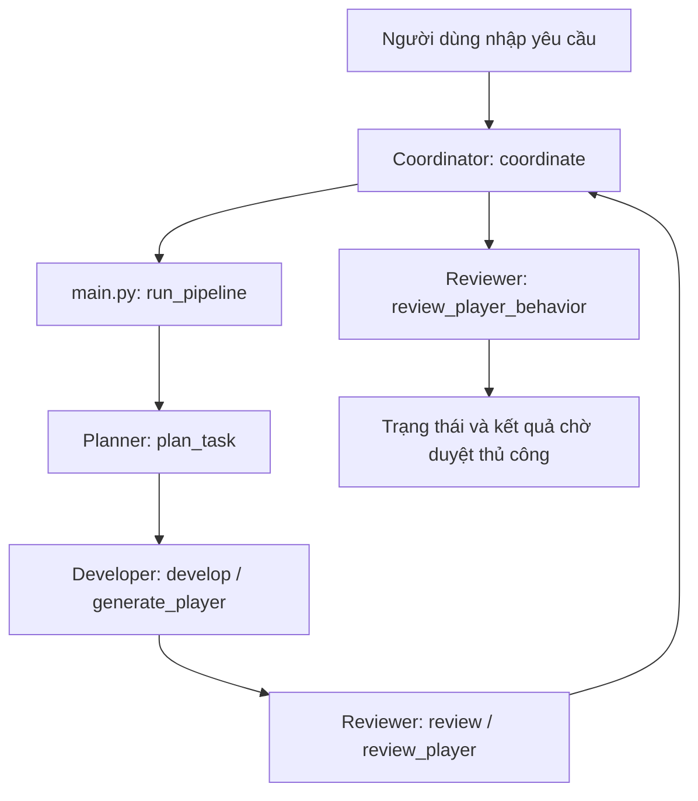

# Kiến trúc Godot AI Agents — 4 vai trò (offline)

> Tài liệu mô tả mã nguồn trên nhánh `main`. Đây là pipeline Python có quy tắc xác định (deterministic), **không phải 4 AI Agent sử dụng LLM**. Tài liệu MVP 3 Agent trước đây được kế thừa, không đồng nghĩa đã tích hợp vào Godot.

## Luồng xử lý

## Vai trò và chức năng đã có

| Vai trò | File | Chức năng trong mã nguồn hiện tại |
| --- | --- | --- |
| Coordinator | `coordinator.py` | Gọi `run_pipeline`, tổng hợp báo cáo, kiểm tra tĩnh bổ sung và đặt trạng thái `failed`, `planning_only` hoặc `ready_for_manual_review` |
| Planner | `planner.py` | Phân loại yêu cầu theo từ khóa nhân vật/menu/chiến đấu; trả về kế hoạch ba bước, từ chối đầu vào rỗng |
| Developer | `developer.py` | `develop()` tạo nhật ký `simulated`; `generate_player()` sinh mẫu Python `player.py` vào thư mục đầu ra |
| Reviewer | `reviewer.py` | Đối chiếu các bước mô phỏng, phân tích cú pháp Python bằng AST, kiểm tra lớp `Player`, phương thức và chuỗi bốn hướng di chuyển |

`main.py` là lớp chạy pipeline; `coordinator.py` là lớp điều phối mở rộng phía trên.

## Ranh giới của kết quả kiểm tra

- `review_player()` và `review_player_behavior()` kiểm tra **tĩnh** mã Python, không thực thi nhân vật trong game.
- Kiểm tra sự xuất hiện của `up/down/left/right` **không chứng minh** di chuyển và va chạm hoạt động đúng.
- `ready_for_manual_review` nghĩa là đủ điều kiện **để người phát triển xem xét**, không phải bản vá đã được tích hợp.
- README ghi nhận baseline **22 passed** trước giai đoạn bổ sung dependency; đó không phải kết quả chạy test mới tại thời điểm cập nhật tài liệu.

## Hướng tích hợp (chưa hoàn thành)

1. Tích hợp OpenAI Agents SDK để Agent thực sự dùng mô hình LLM, có quản lý lỗi và chi phí.
2. Dùng Godot Editor MCP để đọc scene và node **trên bản sao** dự án.
3. Tạo GDScript/bản vá trong vùng cho phép, kiểm tra diff và yêu cầu phê duyệt trước khi ghi.
4. Chạy kiểm thử liên quan đến Godot và thu thập bằng chứng thực nghiệm.

Kết nối MCP thủ công với bản sao Godot từng thành công trong môi trường phát triển Windows, nhưng kết nối qua Codex vẫn được chẩn đoán; **không coi là đã tích hợp MCP vào pipeline 4 Agent trên GitHub**.
